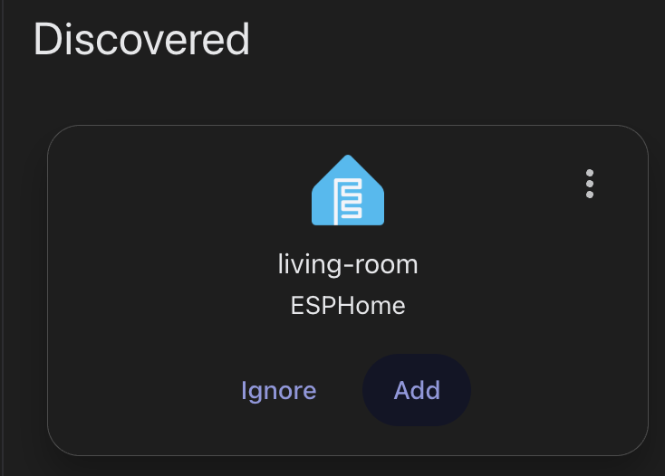
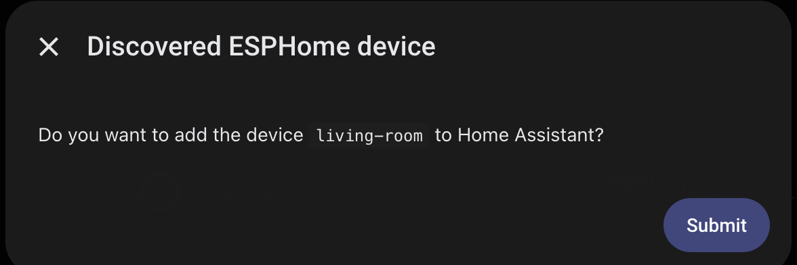

# EchoLocal

<a href="https://github.com/ygelfand/echolocal/stargazers"></a>
<a href="https://github.com/ygelfand/echolocal/releases"></a>
<a href="https://github.com/ygelfand/echolocal/releases/latest"></a>
<a href="https://github.com/ygelfand/echolocal/actions/workflows/ci.yml"></a>
<a href="https://buymeacoffee.com/ygelfand"></a>
<a href="https://discord.gg/efWnv89pg2"></a>
<a href="https://www.echolocal.link"></a>

Turn an Amazon Echo Dot or Echo Show into a local Home Assistant voice satellite, speaker and display.

A pure-Go replacement for Amazon's services. It speaks the ESPHome native API, so Home Assistant
discovers it the way it discovers any ESPHome device.

<p align="center">
  
</p>

## Devices

| Device                | Codename | OS          | Status    |
| --------------------- | -------- | ----------- | --------- |
| Echo Dot (2nd gen)    | biscuit  | Fire OS 6.x | Supported |
| Echo Show 5 (1st gen) | checkers | Fire OS 6.x | Supported |
| Echo Show 5 (2nd gen) | cronos   | Fire OS 6.x | Supported |
| Echo Show 8 (1st gen) | crown    | Fire OS 6.x | Supported |
| Echo Show 8 (2nd gen) | athena   | Fire OS 7.x | Supported |

## Additional devices supported by our sister project [LANovo](https://github.com/ygelfand/LANovo)

| Device                  | Codename  | OS                 | Status    |
| ----------------------- | --------- | ------------------ | --------- |
| Lenovo Smart Display 10 | blueberry | Android Things 8.x | Supported |
| Lenovo Smart Display 8  | amber     | Android Things 8.x | Supported |
| Lenovo Smart Display 7  | ivy       | Android Things 8.x | Supported |
| JBL Link View           | opal      | Android Things 8.x | Supported |
| Lenovo ThinkSmart View  | penghu    | Android 8.x        | Supported |

## Features

### Every device

- **Wake words** on the device with [microWakeWord](https://github.com/kahrendt/microWakeWord) and
  [openWakeWord](https://github.com/dscripka/openWakeWord). Two assistants, each with its own wake
  word and Assist pipeline. "Stop" works without a wake word.
- **Speaker**: a Home Assistant `media_player` for announcements, TTS and music, ducking under the
  wake word. A Sendspin player for Music Assistant. Chromecast receiver (audio only on the Dot).
- **White noise**: two layers from white, pink, brown, rain, ocean, fan, fire, brook, cabin,
  crickets and wind.
- **Intercom**: calls between devices on your network. Audio on the Dot, audio and video on the Shows.
  Broadcasts to every device at once, and "call the kitchen" or "broadcast dinner is ready" by
  voice with the EchoLocal integration, which also calls an Echo Show from a Home Assistant
  dashboard. A home key keeps calls and broadcasts to your own devices.
- **Timers and alerts**, with custom tones for chimes, timers and wake sounds.
- **Bluetooth proxy** for Home Assistant, so the device extends your Bluetooth for integrations
  like [Bermuda](https://github.com/agittins/bermuda). While the proxy is on, the device also
  advertises an iBeacon with UUID `9c5fa6f1-91c4-4f56-bb9f-d92acfd9d40b`, major `1`, and a minor
  from the last two bytes of its factory MAC, for tools like
  [BLE Positioning System](https://github.com/Hogster/BPS).
- **Light sensor**, reported to Home Assistant.
- **Updates** from Home Assistant, stable or development channel, or any recent version by name to
  roll back.
- **A web page** on every device over HTTPS: every setting with search, alarms, calls and
  broadcasts, logs, and on an Echo Show a live view of the screen. Behind it is an HTTP API for
  scripts. The certificate is self-signed, or comes from [Cert Warden](https://www.certwarden.com)
  if you run one. See [In a browser](https://www.echolocal.link/use/web/).

### Echo Dot

**LED ring.** Twelve individually addressable segments, effects for ambient, motion, alerts and
room-reactive behavior, and a color per segment. The ring can follow the room's volume.

**Buttons** as Home Assistant events: press and hold on every button, and double and triple taps
on the action button.

### Echo Show

- A native dashboard with a clock in one of eight faces, the weather, and your Home Assistant
  lights and switches control
- [Tessera](https://github.com/MaxGramser/homeassistant_espscreen) dashboards
- 33 audio visuals on the GPU, for the screen saver or for each assistant while it listens and
  answers
- Nine styles and eighteen color themes
- Messages from Home Assistant, timers on screen
- An Immich photo screen saver
- A Chromecast receiver for YouTube, YouTube TV and Prime Video and more
- A Bluetooth speaker
- An RTSP camera on port 8554 with ONVIF discovery, and a snapshot camera in Home Assistant.
- A Cameras app for your Home Assistant cameras, with live video and audio through the
  integration, and full-screen Lights and Switches apps
- Settings on the screen or from Home Assistant, a PIN to lock them, and config sync between
  devices

## The optional integration

Everything above works with stock Home Assistant. The
[EchoLocal integration](https://github.com/ygelfand/echolocal-hacs) (HACS) adds a dashboard and
cards for these devices, Fleet to compare settings across devices and copy them from one to the
others, calls to an Echo Show from a dashboard, turn history with recordings, a wake word library,
custom tones, groups and a health view. It works with
[LANovo](https://github.com/ygelfand/LANovo) displays too, side by side on the same dashboard. See
[The EchoLocal integration](https://www.echolocal.link/start/integration/).


## Installing

You need the device connected over USB with TWRP as its recovery. Follow the XDA guide for yours:

- [Echo Dot (2nd gen)](https://xdaforums.com/t/unlock-root-twrp-unbrick-amazon-echo-dot-2nd-gen-2016-biscuit.4761416/), on Fire OS 6
- [Echo Show 5 (1st gen)](https://xdaforums.com/t/unlock-root-twrp-unbrick-amazon-echo-show-5-1st-gen-2019-checkers.4762900)
- [Echo Show 5 (2nd gen)](https://xdaforums.com/t/unlock-root-twrp-unbrick-amazon-echo-show-5-2nd-gen-2021-cronos.4772596)
- [Echo Show 8 (1st gen)](https://xdaforums.com/t/unlock-root-twrp-unbrick-amazon-echo-show-8-1st-gen-2019-crown.4766687)
- [Echo Show 8 (2nd gen)](https://xdaforums.com/t/unlock-root-twrp-unbrick-amazon-echo-show-8-2nd-gen-2021-athena.4804958/)

Download `echolocal` for your computer from the
[latest release](https://github.com/ygelfand/echolocal/releases/latest):

| Computer            | File                           |
| ------------------- | ------------------------------ |
| Mac (Apple silicon) | `echolocal_darwin_arm64`       |
| Mac (Intel)         | `echolocal_darwin_x86_64`      |
| Linux (x86-64)      | `echolocal_linux_x86_64`       |
| Linux (ARM64)       | `echolocal_linux_arm64`        |
| Windows (x86-64)    | `echolocal_windows_x86_64.exe` |
| Windows (ARM64)     | `echolocal_windows_arm64.exe`  |

On macOS and Linux:

```sh
mv echolocal_darwin_arm64 echolocal
chmod +x echolocal
xattr -d com.apple.quarantine echolocal   # macOS only, if Gatekeeper blocks it
./echolocal install --name living-room
```

On Windows:

```powershell
Rename-Item echolocal_windows_x86_64.exe echolocal.exe
.\echolocal.exe install --name living-room
```

The installer detects the device, flashes its boot image, installs EchoLocal, and asks for your
Wi‑Fi if the device isn't on a network yet.


It then shows up in Home Assistant. Add it, and Home Assistant sets its encryption key.

<p align="center">
  
  
</p>

The full guide, with every setting and where to find it, is at
[www.echolocal.link](https://www.echolocal.link).

## Building it yourself

```sh
make build-echod                  # echod for the Echo Dot
make build-echod BOARD=crown      # echod for an Echo Show: checkers, cronos, crown or athena
make install-echod                # build, install and restart it on the attached device (requires prior full installation)
```

## How it fits together

- **echod** runs on the device: the hardware, the screen, the wake word engines, the conversation,
  and an ESPHome native API server.
- **echolocal** is the host CLI: installing, Wi‑Fi, and offline tools for debugging the device.

For opt-in troubleshooting of unexpected activations, see [wake diagnostics](internal/wakecapture/README.md).
